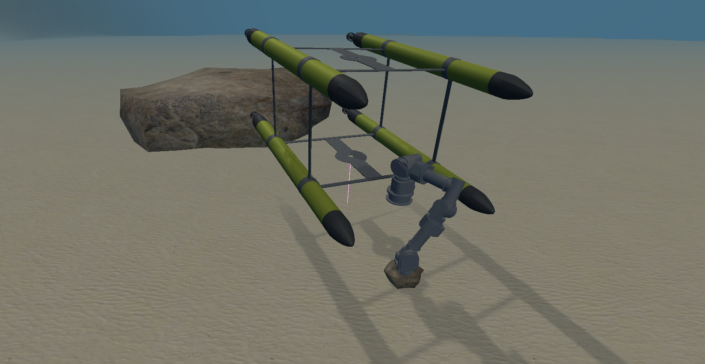
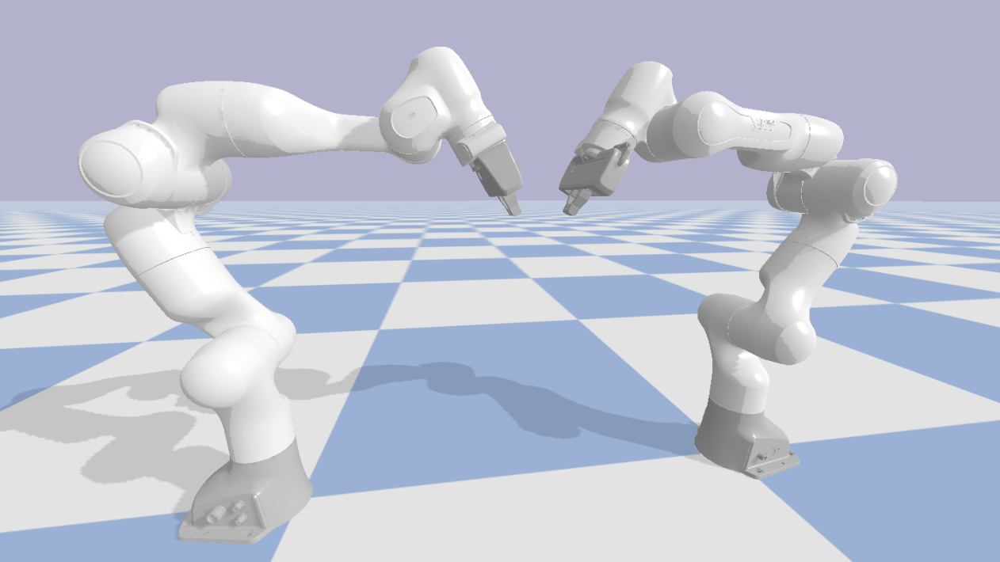

# Cooperative Robotics

Implementation of task-priority control and cooperative manipulation algorithms for robotic systems, developed as part of the *Cooperative Robotics* course of the MSc in Robotics Engineering at the University of Genoa.

The project explores hierarchical control, robotic manipulation, and coordination between multiple robotic systems through three simulation-based exercises.

## Project Overview

The project is organized into three exercises:

### 1. Underwater Vehicle Navigation and Manipulation

Implementation of a complete mission involving an underwater vehicle equipped with a robotic manipulator.

The mission consists of three sequential actions:
- **Safe waypoint navigation:** navigate the vehicle to a target pose while enforcing a minimum-altitude safety constraint.
- **Landing:** align the vehicle with a target nodule and descend to the landing position.
- **Fixed-base manipulation:** keep the vehicle stationary while moving the manipulator towards the target.

A workspace-based reachability check is used to adjust the vehicle's landing position when necessary, ensuring that the target remains reachable by the manipulator.

The control architecture uses hierarchical tasks, including vehicle position and orientation control, safety constraints, target alignment, and end-effector positioning.

### 2. Bimanual Manipulation

Implementation of a task-priority inverse kinematics (TPIK) controller for two Franka Panda manipulators treated as a single robotic system.

The exercise consists of:
- Moving both end-effectors towards predefined grasping points.
- Enforcing joint-limit and minimum-altitude safety constraints.
- Implementing a **Bimanual Rigid Grasping Constraint** to maintain a fixed relative pose between the two end-effectors.
- Moving the grasped object towards a desired target position.

Both standard and stressed scenarios are evaluated to verify that safety constraints can override the desired object motion while preserving the rigid grasp.

### 3. Cooperative Manipulation

Implementation of a cooperative manipulation strategy considering the two Franka Panda manipulators as independent robotic systems.

Each manipulator first computes its own non-cooperative motion using an independent TPIK controller. The resulting end-effector velocities are then exchanged and combined to compute feasible cooperative velocities.

A second TPIK computation tracks these cooperative references while preserving local safety constraints.

The approach is evaluated in both reachable and unreachable target configurations, demonstrating how cooperation modifies the robots' motion when one manipulator encounters kinematic limitations.

## Key Concepts

- Task-priority inverse kinematics (TPIK)
- Hierarchical task control
- Equality and inequality constraints
- Null-space projections
- Robotic Jacobians and Cartesian control
- Joint-limit and minimum-altitude constraints
- Bimanual rigid grasping
- Cooperative velocity computation
- Distributed multi-robot coordination

## Results

The simulations demonstrate several key properties of the implemented control architectures:

- **Safe navigation and landing:** safety constraints prevent the underwater vehicle from descending below the prescribed minimum altitude.
- **Workspace-aware manipulation:** vehicle positioning is adjusted to ensure that the target is reachable by the manipulator.
- **Rigid bimanual grasping:** the distance between the two end-effectors remains constant at the object length of 0.10 m, including when safety constraints modify the commanded motion.
- **Cooperative manipulation:** the two independent manipulators coordinate their motion while maintaining a constant 0.06 m distance between their tool frames.
- **Constraint handling:** unreachable goals highlight how cooperative control modifies the nominal motion to preserve feasibility.

The report includes task hierarchy tables, mathematical derivations of the task Jacobians and control references, and simulation plots comparing desired and actual robot velocities.

## Tools & Technologies

- MATLAB
- Python
- Franka Panda simulation
- ROBUST simulation and Unity visualization tools
- Robotic System Toolbox

## Authors

- Paolo Laishram
- Marcello Ori

*Course project — Cooperative Robotics, MSc in Robotics Engineering, University of Genoa, January 2026.*
